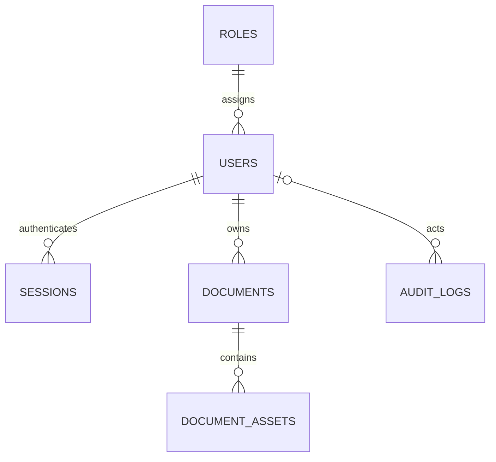

# PostgreSQL design

Administrators and users share `users`; `roles` constrains role names. UUID keys prevent sequential public account/document identifiers. Usernames are lowercase and unique. Active status and mandatory-password-change are separate. Argon2 hashes are never returned through the API. Password resets are administrative operations, so no emailed reset-token table is required.

`sessions` stores SHA-256 digests of random bearer tokens, user foreign key, idle activity and absolute expiration. `login_limits` provides shared throttling across restarts. `documents` stores owner, status, expiry and the existing structured result as JSONB. `document_assets` stores original PDF and rendered pages as bytea; temporary OCR intermediates are not permanent records. `saved_reviews` preserves exact-hash reviewed results. No patient data is copied into audit metadata.

`audit_logs` stores immutable actor snapshots, action/module/record, server timestamp, request ID, direct peer IP and allowlisted metadata. Actors reference users; users are deactivated rather than deleted. Audit insertion shares the transaction of each business mutation. Runtime role cannot update/delete/truncate logs, and a trigger rejects mutation even by the migration owner (a database superuser can deliberately override it).

Indexes cover owner/date listings, session lookup/expiry, document expiry, account status and audit time/actor/action/module. Pagination is bounded. Additional permissions table is unnecessary for the initial fixed admin/user role matrix.

## Local setup

Run `powershell -File scripts/setup-local-db.ps1` with PostgreSQL 18 installed. This creates only a new `.local-postgres` cluster on loopback port 55432 and a new `clarity_portal` database. It refuses to overwrite an existing cluster or `.env`. Runtime and migration credentials are generated randomly and stored only in ignored `.env` and `.env.migration`. Protect that file and the cluster directory using OS permissions. Run `node scripts/migrate.mjs` from the project root. Migrations are checksum-checked, locked and transactional. Never edit an applied migration; add a new numbered file.

For an existing managed PostgreSQL instance, create dedicated `clarity_owner` and restricted `clarity_app` roles and a dedicated database; set the two connection URLs, use certificate-verified TLS per your database provider, then run migrations. Do not point local setup at an existing cluster.

Review JSON files are imported idempotently; original files and backup archive remain unchanged. No previous relational database existed. Existing anonymous in-memory jobs are temporary and cannot safely be assigned to arbitrary accounts; their original saved reviews/output remain available on disk.

## Backup and recovery

Use PostgreSQL `pg_dump --format=custom --file=<protected-backup>` with migration credentials supplied through a protected PGPASSFILE, never command-line passwords. Back up the entire database (including bytea assets and reviews), migration files and secure configuration separately. Encrypt backups, restrict access and test restoration into a new empty database with `pg_restore --no-owner`; restore role grants via migrations. Do not restore over a live database without approval. Audit retention must be handled by an explicit operator policy, not normal application deletes. Retention defaults to the existing two-hour document lifetime; configure DOCUMENT_RETENTION_HOURS before deployment. Application accounts and audit history do not expire with documents.

## Relationships

The local live database is clarity_portal_live with runtime role clarity_live_app. The retained QA database is clarity_portal with role clarity_app; migration grants use the validated DATABASE_RUNTIME_ROLE setting. A separate restore-test database is retained; no existing database was deleted.
